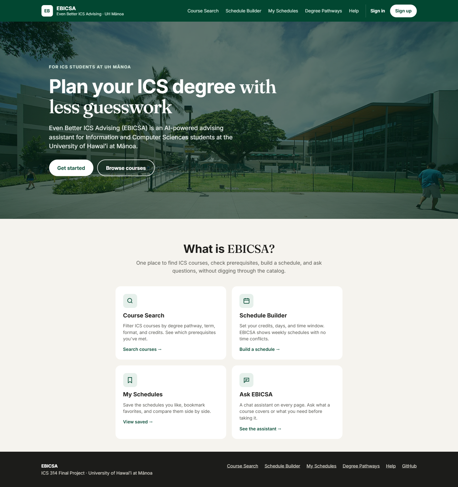
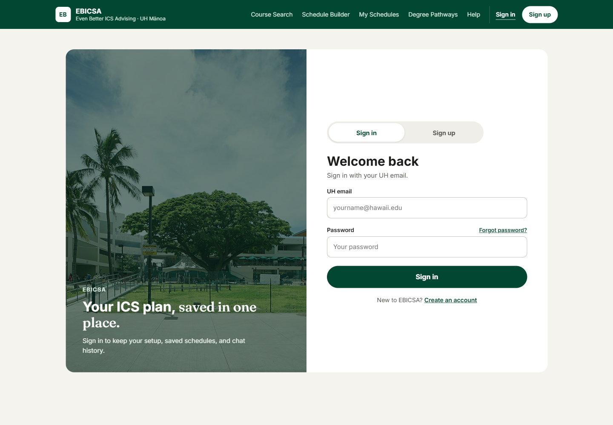
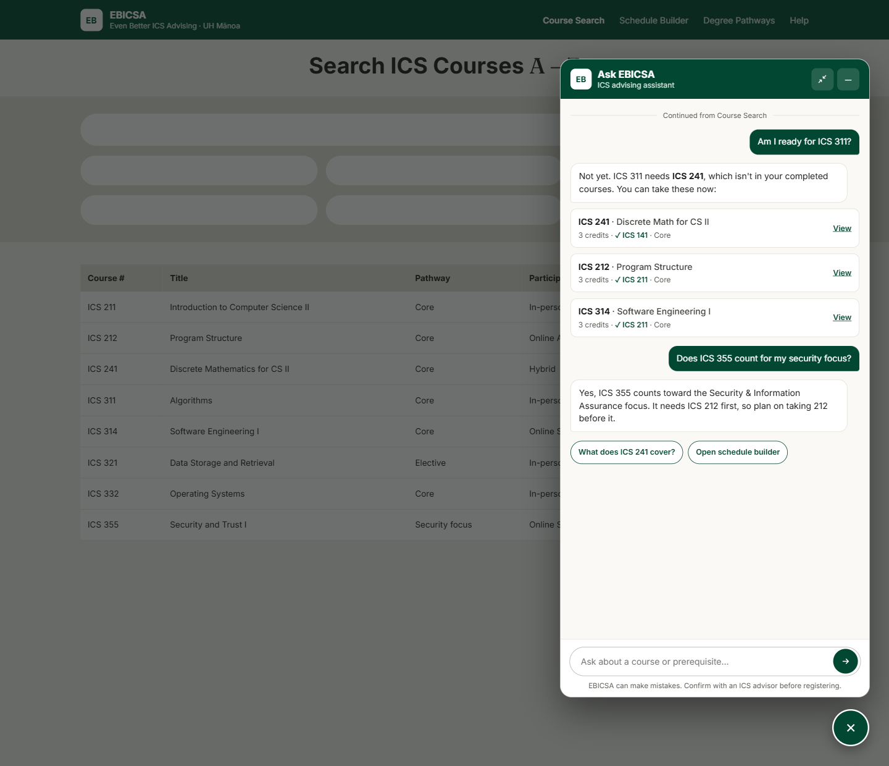
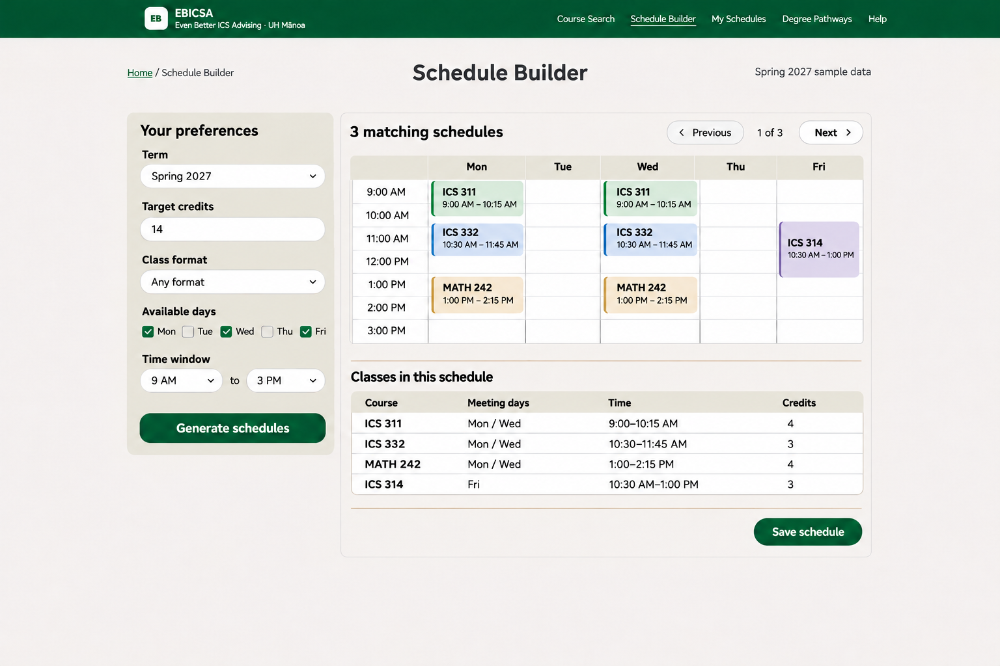
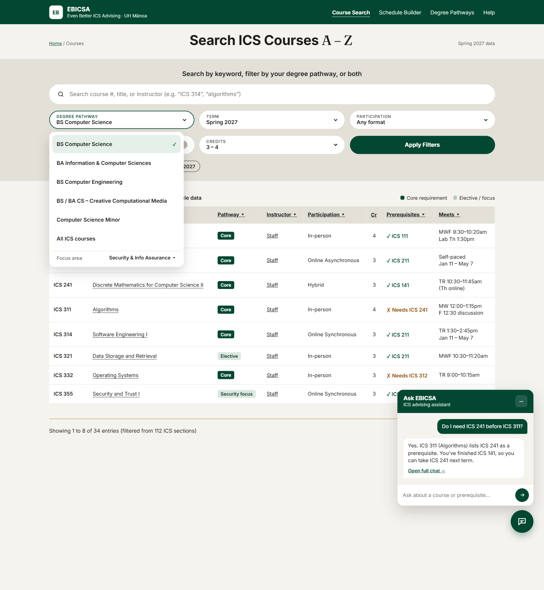
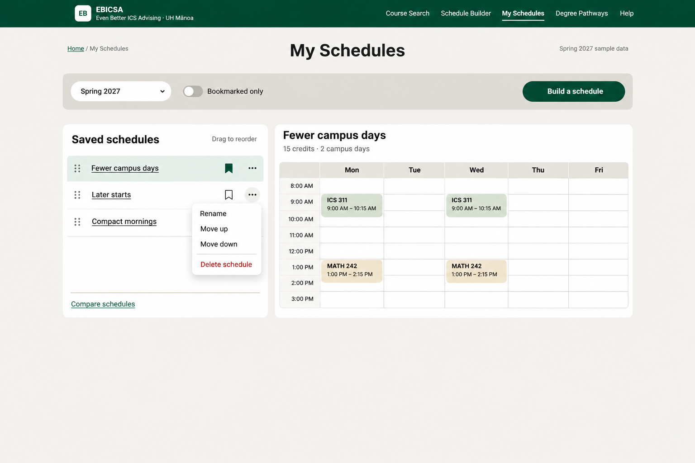

# Even Better ICS Advising (EBICSA)

> **Project status:** Milestone 1 in progress (due Nov 19, 2026). Pages shown below are mockups subject to change!

## Table of contents

* [Overview](#overview)
* [Deployment](#deployment)
* [User Guide](#user-guide)
* [Developer Guide](#developer-guide)
* [Development History](#development-history)
* [Team](#team)

## Overview

Even Better ICS Advising (EBICSA) is an AI-powered advising assistant for Information and Computer Sciences (ICS) students at the University of Hawaiʻi at Mānoa.

Tools like STAR can tell a student which courses come next, but turning that list into a semester schedule that works for them is still left to the student. EBICSA is built to simplify this taxing process. Students can ask questions about ICS courses and degree requirements, and the system generates possible schedules for spring/summer/fall semester based on how they actually want to take classes.

When complete, EBICSA will provide:

* A chat assistant that answers questions about ICS courses, prerequisites, and degree requirements.
* A schedule builder that generates possible course combinations based on a student's credit target, preference for in-person or online classes, and available free times.
* A course and requirement browser for exploring ICS courses and any gen-eds.
* Student accounts, so students can save and compare schedules.

<!-- Update this list to match our actual stack once it's decided -->
EBICSA is planned to use the following technologies:

* [Next.js](https://nextjs.org/) and [React](https://react.dev/) for the web application.
* [Vercel](https://vercel.com/) for deployment.
* A large language model API ([Gemini](https://ai.google.dev/) or [Groq](https://groq.com/)) to power the chat assistant

## Deployment

<!-- Replace with the live link once the app is deployed for Milestone 1. -->
The deployed application will be available on Vercel as part of Milestone 1.

## User Guide

This section shows the pages planned for EBICSA. The images below are mockups and will be replaced with screenshots of the running application as development progresses.

### Landing Page

The landing page is presented to users when they visit the top-level URL to the site. It explains what EBICSA does and provides a place to sign in. 

### Sign In and Sign Up

Returning students sign in with an existing account. New students can register through the Sign Up page.

### Chat Assistant

The chat assistant lets students ask questions about ICS courses, prerequisites, and degree requirements in plain language.

### Schedule Builder

The schedule builder asks for a target number of credits, a preference for in-person or online classes, and available free times. It then generates possible schedules that fit those constraints.

### Course Browser

The course browser lets students explore ICS courses and see how each one fits into degree requirements.

### My Schedules

Signed-in students can save the schedules they like and compare them later.

## Developer Guide

<!-- Fill in once the application repo has code. -->
Installation and development instructions will be added once the application code is in place. The source code is in the [EBICSA GitHub organization](https://github.com/ebicsa-uhm).

## Development History

The development process for EBICSA follows [Issue Driven Project Management](https://courses.ics.hawaii.edu/ics314f26/morea/project-management/reading-guidelines-idpm.html) practices. In a nutshell:

* Development consists of a sequence of Milestones.
* Each Milestone is specified as a set of tasks.
* Each task is described using a GitHub Issue and is assigned to a single developer to complete.
* The work for each task is done in a git branch named "issue-XX", where XX is the issue number.
* When a task is complete, its issue is closed and its branch is merged into main.
* The state of each task for a Milestone is managed using a GitHub Project Board.

### Milestone 1: Mockup development

The goal of Milestone 1 is to deploy the application with a landing page and mockups of the other pages in the system.

Milestone 1 is managed using the [EBICSA GitHub Project Board M1](https://github.com/orgs/ebicsa-uhm/projects/2).

## Team

EBICSA is designed, implemented, and maintained by:

* [Chicco](https://github.com/chicco-m)
* [Rodemar](https://github.com/rodc808)
* [Rocky](https://github.com/rockymacasio)

Read our [Team Contract](https://docs.google.com/document/d/1bH0cZWCzZ5PyjGmNv91xsEbVApZyOvctTOzupn-9Bns/edit?usp=sharing).
